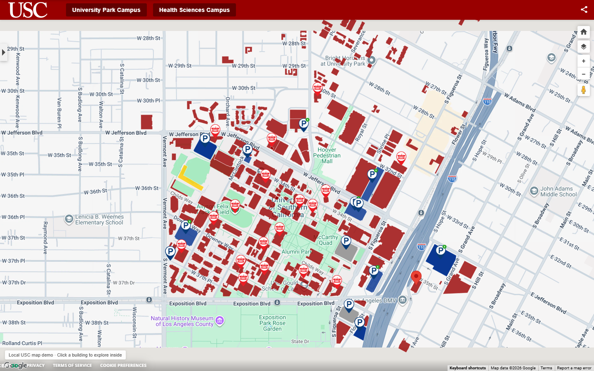
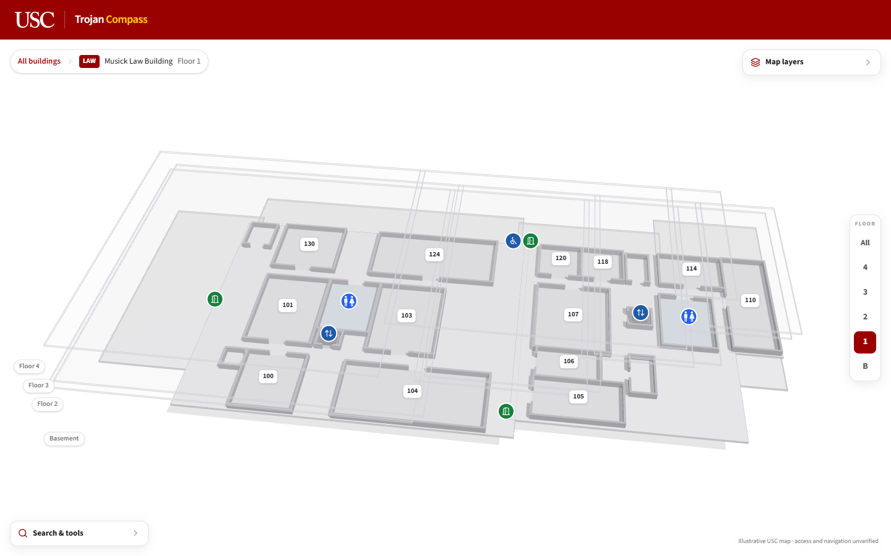
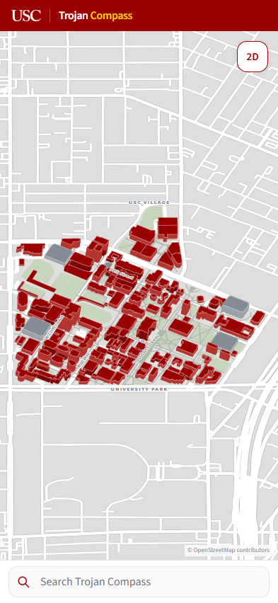
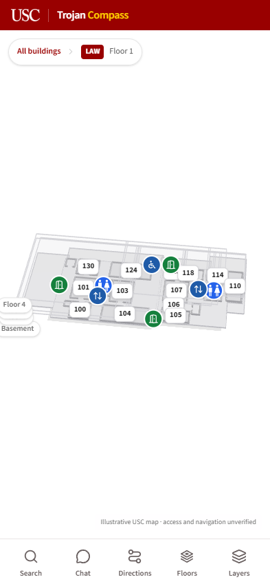

# Trojan Compass

**Find the building. Find the floor. Find your room.**

Trojan Compass brings USC's campus and building interiors into one interactive map. Explore campus, search for a room, and follow indoor directions in 3D, on the web or through the iPhone app.

[See the app](#see-the-app) · [What it does](#what-it-does) · [Try it locally](#try-it-locally) · [What's next](#whats-next)

## Why we built it

Getting to the right building is only part of finding a classroom. Once you're inside, you still need to work out the floor, the room, and which stairs or elevator will get you there.

Trojan Compass connects those steps. It gives students and campus visitors a way to explore a building before walking through the door, with searchable rooms and a floor plan they can move around.

## See the app

### Campus to classroom

Browse the campus map, find a building, and open its interior. Floor-plan entry is currently available for **Musick Law Building (LAW)** and **Dr. Joseph Medicine Crow Center (DMC)**. Other buildings show **“Floor Plan unavailable”** in their hover popup.



Inside LAW, explore rooms across floors and locate entrances, restrooms, stairs, and elevators.



### Built for a phone, too

The mobile campus has a 2D/3D toggle. Inside a building, Search, Chat, Directions, Floors, and Layers stay within reach in the bottom toolbar.

<p>
  
  
</p>

*Phone screenshots show the shared UI in a 393 × 852 browser preview.*

## What it does

| Feature | Experience |
| --- | --- |
| Campus exploration | Search buildings, inspect their footprints, and see which floor plans are available. |
| Interactive interiors | Orbit and zoom around a building, switch floors, or view the floors together. |
| Room search | Enter a room such as `LAW 101` and find it on the map. |
| Indoor directions | Choose a starting point and destination, select stairs or elevators, and follow the displayed route and instructions. |
| Map layers | Show the rooms and facilities you need, including restrooms and entrances. |
| AI chat | Ask for a room or directions in plain language when the AI provider is configured. |
| Trojan guide | Move the guide to set your current location. Double-click it for a dance. |

### A quick walkthrough

1. Open the campus map and enter **LAW**.
2. Open **Search & tools** on desktop, or **Search** on a phone, and find `LAW 101`.
3. Request directions from `LAW 101` to `LAW 107`.
4. Explore another floor, toggle map layers, then use **All buildings** to return to campus.

## How we built it

| Layer | Technology |
| --- | --- |
| Web app | Next.js, React, TypeScript, Tailwind CSS |
| 3D interiors | Three.js |
| iPhone app | SwiftUI and WKWebView |
| Backend | Express and TypeScript |
| Shared API | OpenAPI contracts and generated TypeScript models |
| Optional AI | OpenAI for structured intent interpretation |
| Campus geography | OpenStreetMap data and the supplied USC campus map assets |

The web and iPhone clients share one backend for building data, search, routes, and chat. The iPhone app bundles the web interface and uses native transport to reach the API.

Chat turns a request into a structured action; the backend resolves the actual room and calculates the route. Building geometry and routes use the same versioned dataset, keeping the location shown on screen aligned with the directions returned by the server.

### The hard parts

Connecting campus footprints to indoor rooms meant handling building names, floor identifiers, and local coordinates consistently. DMC, for example, still uses the legacy code `VKC` internally.

The same 3D interior also needs to work with a desktop mouse and a small touchscreen. The phone layout moves tools into compact sheets and a bottom toolbar so the map remains usable.

## What's next

The current project demonstrates campus exploration and indoor wayfinding. These are the next additions needed to make it useful across USC:

- [ ] **More verified floor plans.** Expand beyond LAW and DMC using reviewed building plans, measured dimensions, and confirmed room locations.
- [ ] **Connected outdoor and indoor directions.** Link campus walkways to building entrances so one route can take you between buildings and into the right room.
- [ ] **Verified accessible routes.** Add confirmed ramp access, doorway clearances, elevator availability, and step-free connections. Selecting elevators alone cannot establish accessibility.
- [ ] **Official class and event locations.** Connect current USC schedules to rooms, replacing synthetic examples with authorized data sources.
- [ ] **A tested iPhone release.** Complete native simulator and device testing, including touch gestures, keyboard behavior, safe areas, and VoiceOver, then prepare a TestFlight build.
- [ ] **A hosted public demo.** Deploy the API and web app with reviewed map data so visitors can try the project without local setup.

## Try it locally

You need **Node.js 22.9+**, **npm**, and **Python 3**.

```sh
npm ci
npm run dev:demo
```

| Service | Address |
| --- | --- |
| Desktop campus | http://localhost:3001 |
| iPhone campus preview | http://localhost:3101 |
| Building interiors | http://localhost:3000 |
| API | http://localhost:4000 |

Use browser device mode for the iPhone preview. To run only the interior viewer and API, use `npm run dev` instead.

### Enable AI chat

Search and directions work without an AI key. For chat, copy `server/.env.example` to `server/.env` and configure:

```dotenv
AI_PROVIDER=openai
OPENAI_API_KEY=your-key
OPENAI_MODEL=your-model
```

Use a model available to your account that supports structured outputs, then restart the API. Keep the key on the server. See the [backend guide](docs/backend-guide.md) for configuration.

### Open the iPhone project

On a Mac with Xcode, start the API and open `mobile/TrojanCompass.xcodeproj`. Choose an iPhone simulator and run the Debug configuration.

The simulator defaults to `COMPASS_API_BASE_URL=http://127.0.0.1:4000/api`. A physical iPhone needs an API address reachable from the device. See [iOS setup](mobile/README.md) for the full instructions.

## Current scope

The bundled maps and routes are **illustrative and unverified**. Some geometry is inferred, and dimensions include estimates. They should not be used as verified campus navigation. The Accessibility option selects elevators; it does not certify a step-free route. Cross-building routing requires a validated outdoor network, and any bundled class or event examples are synthetic.

## Sources and documentation

The mobile campus uses © [OpenStreetMap contributors](https://www.openstreetmap.org/copyright). The desktop map retains the supplied USC map and its source credits. See [map sources and attribution](demos/usc-map/MAP-SOURCES.md) for provenance and licensing.

For implementation details, see [architecture](docs/architecture.md), the [API documentation](docs/api.md), and [iOS setup](mobile/README.md).
