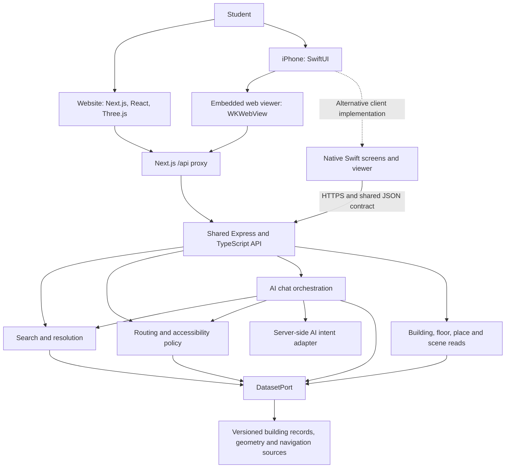
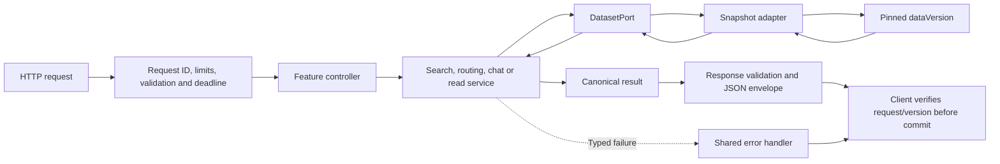
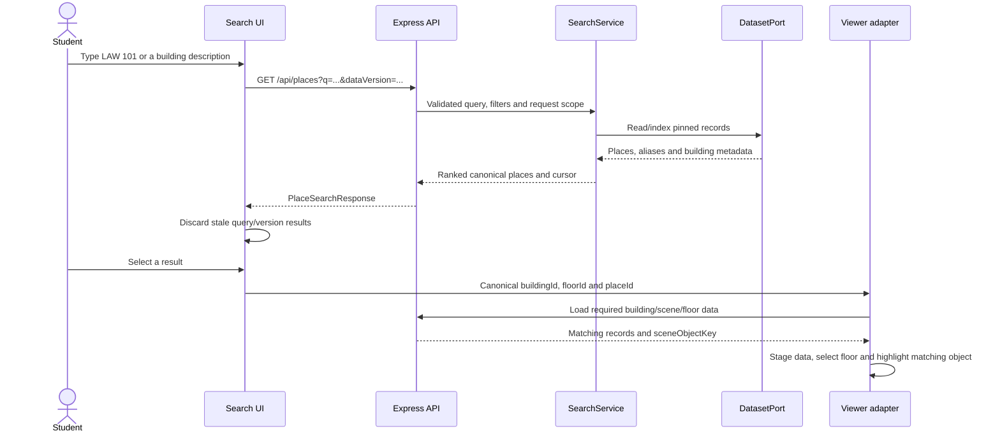
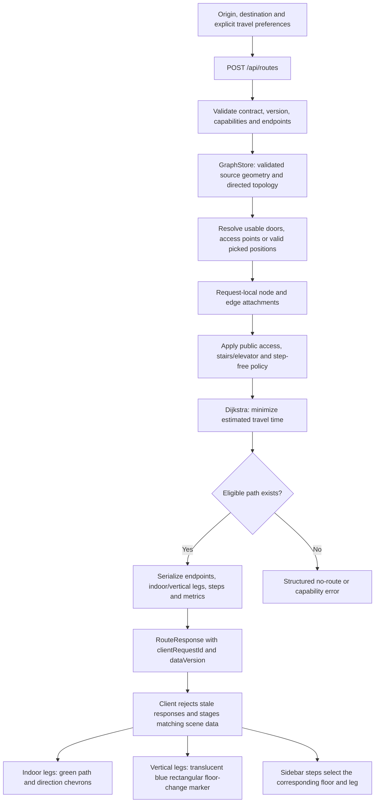
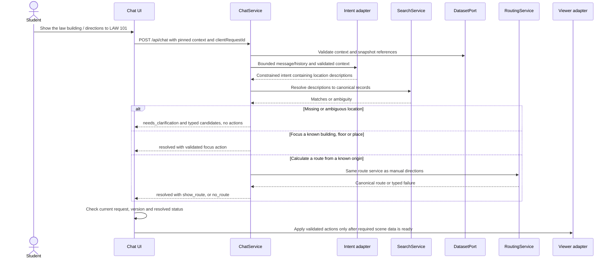
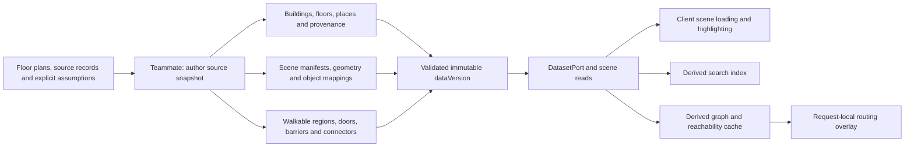

# Trojan Compass architecture

Trojan Compass is a USC building exploration application with a shared TypeScript backend for the website and iPhone app. Students search for buildings and rooms, explore floors, highlight destinations, and optionally request indoor directions through manual controls or AI chat.

This document defines the architecture and ownership boundaries. The integration branch now connects Eddie's services to the teammate's published building data and API-backed viewer. See [integration review](integration-review.md) for acceptance evidence, known publication gaps and merge guidance, and [backend guide](backend-guide.md) for implementation details. The mobile pull request integrates the Swift application under `mobile/`; see [mobile integration](mobile-integration.md).

## 1. Application boundaries



- **Server:** query normalization, ranking, canonical location resolution, graph validation, pathfinding, access policy, AI interpretation, and validated map actions.
- **Web/mobile clients:** drawing, camera movement, gestures, floor separation, labels, animation, highlighting, input state, and displaying returned directions.
- **Data layer:** building/floor/place records, scene manifests, coordinate calibration, object mappings, navigation source topology, and provenance.
- **Shared contract:** JSON requests/responses, stable identifiers, enums, error envelopes, and fixtures. Swift decodes the same HTTP shapes as web.

The embedded viewer owns requests and map state in the current GitHub iPhone shell. A future native screen can own requests instead, but one user action must have one request owner. Rendering and animation stay on the device after data has loaded.

Navigation is optional. A building can support search, floor exploration, and highlighting while navigation is unavailable. Capability flags and endpoint behavior must agree.

## 2. Ownership and parallel work

| Owner                    | Responsibility                                                                               | Main locations                                                                                  |
| ------------------------ | -------------------------------------------------------------------------------------------- | ----------------------------------------------------------------------------------------------- |
| Eddie                    | Search, normalization, ranking, ambiguity resolution and autocomplete behavior               | `server/src/modules/search/`, `web/src/features/search/` integration                            |
| Eddie                    | Graph validation/construction, endpoint snapping, access rules, pathfinding and instructions | `server/src/modules/routing/`, `web/src/features/routing/` integration                          |
| Eddie                    | Chat orchestration, provider adapter, clarification and validated actions                    | `server/src/modules/chat/`, `server/src/integrations/ai/`, `web/src/features/chat/` integration |
| Eddie                    | Server composition, HTTP validation, errors and operational controls                         | `server/src/app.ts`, `server/src/bootstrap/`, `server/src/middleware/`, supporting `lib/`       |
| Data/rendering teammate  | Canonical records, geometry, calibration, source navigation and provenance                   | `server/data/`, `server/src/infrastructure/datasets/`                                           |
| Data/rendering teammate  | Building/floor/place detail reads and scene delivery                                         | `server/src/modules/buildings/`, `places/`, `scenes/`                                           |
| Data/rendering teammate  | Scene loading, camera, picking, highlighting and route drawing                               | `web/src/features/map/`                                                                         |
| Mobile teammate          | Swift application, device networking, mobile controls and viewer integration                 | `mobile/`                                                                                       |
| Affected owners together | Contracts, internal interfaces, coordinate changes, shared viewer wiring and dependencies    | `shared/`, `server/src/ports/`, shared frontend files, root manifests                           |

Search, routing, and AI chat use Eddie's implementation as the integration source of truth. Building listing and building-scoped place queries delegate matching to the same search service. Data services expose records without importing routing or duplicating ranking.

The teammate owns source corridors, doors, entrances, barriers and stair/elevator connections. Eddie owns the derived routing graph, validation and caches. Preserve the teammate's data and scene work while adapting it to the agreed interfaces. Shared files require a deliberate combined edit rather than selecting one entire directory.

## 3. Repository structure

This structure combines the existing top-level directories with the integrated controller/service implementation.

```text
trojan-compass/
├── docs/
│   ├── architecture.md                 # This architecture and data flow
│   ├── ownership.md                    # Team ownership boundaries
│   ├── api.md                          # Endpoint reference/status
│   ├── migration.md                    # Directory migration history
│   └── interiors/                      # Source inventory, assumptions and QA
├── web/                                # Next.js website
│   ├── public/
│   │   ├── models/                     # Viewer/mascot assets; not routing truth
│   │   └── images/
│   └── src/
│       ├── app/                        # Pages, layout and global styles
│       ├── components/
│       │   ├── layout/                 # Shared application shell/header
│       │   └── ui/                     # Shared controls
│       ├── features/
│       │   ├── search/                 # Search UI and canonical selection
│       │   ├── routing/
│       │   │   ├── components/         # Directions inputs and returned steps
│       │   │   └── route-scene.ts      # Route-to-display coordinate adapter
│       │   ├── chat/                   # Conversation UI and action application
│       │   └── map/
│       │       ├── components/         # Viewer state and tool coordination
│       │       ├── api-viewer.ts       # Stage/load/validate scene action batches
│       │       ├── data/               # Presentation adapters and scene state
│       │       └── renderer/
│       │           ├── BuildingScene.tsx
│       │           ├── MapCanvas.tsx
│       │           ├── RouteLine.tsx   # Green walking paths and direction arrows
│       │           └── FloorTransitionBeacon.tsx # Blue floor-change marker
│       └── lib/                        # API transport + LatestRequest cancellation
├── mobile/                             # Mobile teammate's Swift implementation
│   ├── TrojanCompass.xcodeproj/
│   ├── TrojanCompass/                  # SwiftUI, networking/models, viewer shell
│   └── tests/                          # Contract decoding and mobile checks
├── server/
│   ├── src/
│   │   ├── server.ts                   # Environment, startup validation, listen
│   │   ├── app.ts                      # Express composition; injectable services
│   │   ├── bootstrap/services.ts       # Construct shared service instances
│   │   ├── config/env.ts               # Validate server-only configuration
│   │   ├── middleware/                 # HTTP errors and cross-cutting controls
│   │   ├── lib/                        # Contracts, errors, budgets and cache tools
│   │   ├── ports/
│   │   │   ├── service-ports.ts        # Dataset/Search/Routing/Chat interfaces
│   │   │   └── navigation-source.ts    # Internal navigation source contract
│   │   ├── integrations/ai/
│   │   │   ├── intent.ts              # Bounded structured intent interface
│   │   │   └── provider-adapter.ts     # External AI call; credentials stay here
│   │   ├── infrastructure/datasets/    # Snapshot readers and source-data adapters
│   │   └── modules/
│   │       ├── buildings/              # Building/floor metadata reads
│   │       ├── places/                 # Canonical place reads
│   │       ├── scenes/                 # Scene and geometry delivery
│   │       ├── search/                 # Ranking, normalization and cursors
│   │       ├── routing/
│   │       │   ├── graph-store.ts      # Validate/cache immutable directed graphs
│   │       │   ├── source-schema.ts    # Navigation input shape validation
│   │       │   ├── geometry.ts         # Walkable-region and barrier checks
│   │       │   ├── endpoints.ts        # Resolve endpoints and local attachments
│   │       │   ├── pathfinding.ts      # Time-weighted Dijkstra search
│   │       │   ├── reachability.ts     # Reference-entrance access evaluation
│   │       │   ├── serialize-route.ts  # Route legs, metrics and steps
│   │       │   └── preview/            # Explicit development illustration only
│   │       └── chat/                   # Intent -> search/route -> validated actions
│   ├── data/snapshots/                 # Immutable versioned source publications
│   └── tests/                          # Service, data, HTTP and AI adapter checks
├── shared/
│   ├── contracts/                      # OpenAPI YAML and equivalent JSON
│   ├── fixtures/                       # Positive/negative contract examples
│   └── typescript/                     # Shared compile-time wire types
├── scripts/                            # Contract/data/asset tooling
├── demos/usc-map/                      # Retained campus-map demonstration
└── package.json                        # Workspace scripts and dependencies
```

Feature modules in Eddie's implementation follow this pattern:

```text
modules/<feature>/
├── <feature>.routes.ts       # Method/path registration
├── <feature>.controller.ts   # HTTP input/output and service invocation
├── <feature>.service.ts      # Domain behavior behind an interface
└── supporting modules       # Feature-specific algorithms and adapters
```

**Integration state:** `bootstrap/services.ts` is the active composition root. Controllers, source validation and the expanded routing contract are connected to the published-file adapter. `LatestRequest` owns client cancellation; `ViewerSession` stages scene actions; `route-scene.ts` preserves separate walking/vertical legs and canonical units. The Swift app bundles the current web features and forwards API requests to the same backend through native transport.

## 4. Request and backend data flow



`server.ts` owns environment validation, publication preparation, and listening. `app.ts` composes HTTP behavior around injected service instances. Controllers handle transport; services own domain decisions. Services call each other through in-process interfaces, without HTTP calls back into the same server.

| Interface      | Responsibility                                                             | Main consumers                           |
| -------------- | -------------------------------------------------------------------------- | ---------------------------------------- |
| `DatasetPort`  | Pinned building, floor, place, scene, geometry and navigation-source reads | Read services, search, routing and chat  |
| `SearchPort`   | Normalization, ranking, pagination and canonical matches                   | Search endpoint, directory filters, chat |
| `RoutingPort`  | Calculate a route from structured endpoints and preferences                | Manual directions and chat               |
| `ChatPort`     | Interpret a turn, resolve records and return a status/action batch         | Chat endpoint                            |
| Intent adapter | Convert bounded language/context into a constrained intent                 | Chat service only                        |

The shared contract is defined in [OpenAPI](../shared/contracts/openapi.yaml). [Fixtures](../shared/fixtures/) describe wire behavior and are synthetic examples, not runtime campus data. TypeScript types support compilation; runtime checks independently validate requests, source records and responses.

## 5. Search and highlighting flow



Building searches use `GET /api/buildings?q=...`; global place autocomplete uses `GET /api/places`. Building-scoped place reads delegate query matching to the same search implementation. Identical restroom labels remain separate places with distinct IDs. An unresolved typed draft is not a committed endpoint.

## 6. Manual directions flow



The pathfinder uses a priority queue and nonnegative travel-time costs. Elevator state includes the current connector so boarding cost is applied appropriately across its connected floors. Picked-point attachments belong to the request and cannot mutate the shared graph. A same-place request returns an arrival result.

`mode=elevator` excludes stairs. `stepFree=true` additionally requires verified access evidence throughout the route; unknown evidence does not qualify. A picked position must connect to a valid walkable region without crossing a wall or restricted door. Missing outdoor topology produces an explicit unsupported-network error for cross-building directions.

The approved route display preserves horizontal walking legs and vertical legs separately. A blue upright transparent volume encloses the connector landings; an ascending/descending rectangular platform and an up/down floor label indicate the transition. It is a symbolic display marker. The client does not replace the backend route with a diagonal walking line or change physical route distances. Motion respects reduced-motion preferences.

**Development preview:** The compatibility `POST /api/preview/routes` explicitly serves illustrative routes for the existing prototype viewer. It is enabled only for the non-production prototype configuration, marks access/metrics as unverified or estimated, and never acts as an automatic fallback from `/api/routes`. The published viewer does not use this extension; it is not part of the shared production contract.

## 7. AI chat flow



AI interprets language. Search resolves real identifiers. Routing computes paths. The provider cannot author authoritative coordinates, mesh/object mappings, access claims or route geometry. Credentials remain on the server.

Supported actions are `focus_building`, `focus_floor`, `focus_place`, and `show_route`. Chat statuses include `resolved`, `needs_clarification`, `not_found`, `no_route`, and `unsupported`. Non-resolved turns preserve the current map. Provider failures return documented dependency errors rather than a fabricated success.

GitHub currently includes a deterministic local interpreter and an optional external provider. Eddie's local provider implementation uses explicit enabled/disabled configuration, constrained intents, cancellation and admission limits. Provider configuration and startup must be reconciled during integration; a deterministic command parser must not be presented as an external AI model.

## 8. Scene data, coordinates and publication flow



Indoor positions use a right-handed, building-local meter frame with Y up and X/Z horizontal. Outdoor geometry uses explicit WGS84 coordinates. Floor IDs are opaque strings scoped to a building; order/display labels come from floor metadata.

Every selected place, scene, search result and route belongs to one `dataVersion`. Keep place IDs separate from `sceneObjectKey`. Apply asset/display transforms exactly once and invert display transforms when sending picked positions. Floor explosion, route markers and camera animation are presentation effects; they do not modify physical coordinates.

Prototype conversion assumptions must not leak into the API-backed renderer. Eddie's current prototype adapter scales horizontal scene coordinates by 2.4 for LAW and 2 for generated buildings, while Y is already in meters. The incoming API-backed geometry is already canonical; applying the prototype conversion again would misalign paths.

**Published-file adapter:** The runtime now accepts the existing `{dataVersion}` pointer and split building files directly. It also supports `{currentVersion, availableVersions}` with normalized bundles. Source records are preserved; explicit conversion produces the expanded validated navigation source.

The internal navigation source requires geometry, edge details, doors, place access bindings, reference entrances and evidence. The adapter combines source centerlines, barrier boxes, room bounds, explicit doors and connector memberships. Derived corridor links require unobstructed published floor space; missing door/access evidence is never fabricated. Buildings lacking adequate navigation inputs can still expose their directory and scene capabilities.

## 9. HTTP, state and deployment rules

| Concern           | Required behavior                                                                                      |
| ----------------- | ------------------------------------------------------------------------------------------------------ |
| Network ownership | One request owner per user action, including inside WKWebView                                          |
| Versioning        | Discover a version, then pin related reads, routes and chat to it                                      |
| Stale responses   | Cancel or supersede old requests; verify version and POST `clientRequestId` before commit              |
| Errors            | Consistent `APIError` envelope, correlation ID and meaningful HTTP status                              |
| Failure state     | Preserve typed drafts, committed selections and camera until a replacement is ready                    |
| Scene actions     | Stage and validate the complete batch before committing viewer changes                                 |
| Secrets           | Provider keys/configuration stay server-side                                                           |
| Access            | Unknown accessibility remains unknown; explicit evidence is required                                   |
| Caching           | Graphs/indexes keyed by publication; GET revalidation; route/chat responses use `no-store`             |
| Operations        | Runtime validation, bounded bodies/history, time budgets, rate limits and bounded provider concurrency |
| Mobile networking | Use a reachable HTTPS API/viewer URL; phone localhost points to the phone                              |
| Persistence       | Read-only versioned publications; no student account or chat-history database required                 |

These are the integration requirements. Eddie's local HTTP implementation supplies the operational controls; they must remain wired when combining startup and middleware with the dataset/renderer implementation. Multiple replicas may keep their own immutable graph caches; deployment-wide rate/admission limits require a shared mechanism when per-process limits are insufficient.

No account system, public building editor, campus-code module, live event feed or image-analysis pipeline is required by this architecture. Events and image input remain disabled/deferred until separately implemented. Dataset provenance must continue to distinguish illustrative layouts from measured campus information.

## 10. Integration and acceptance

1. Preserve the current GitHub history and create a reviewable integration commit/branch. The integration PR contains the application reconciliation and its tests.
2. Keep Eddie's search, routing, chat, AI adapter and supporting HTTP/service implementation together, including its behavioral tests.
3. Retain teammate data, scene loading, geometry, camera and picking contributions. Keep the snapshot/navigation adapter aligned with the agreed `DatasetPort`.
4. Reconcile `service-ports.ts`, coordinate mappings, startup composition, frontend request ownership and dependency manifests together.
5. Adapt route rendering to canonical scene coordinates while preserving green walking arrows, separate vertical markers and sidebar steps.
6. Replace prototype-generated imports only when their consumers use the new presentation adapters. Remove compatibility scripts/copies after all callers and checks migrate.
7. Resolve the mobile branch's directory migration and Xcode conflicts separately; keep the agreed top-level `web/`, `mobile/`, `server/`, `shared/` layout.
8. Validate shared contract fixtures, type checks, backend/frontend behavior and the production build. Exercise LAW search/highlight, same-floor and cross-floor routes, up/down markers, ambiguous places, access failures, stale replies and chat actions. Test the chosen mobile viewer on an actual supported target.

Read [ownership](ownership.md), [API status](api.md), and [migration](migration.md) with this document. OpenAPI governs public wire shapes; ownership governs implementation responsibility; the internal navigation contract governs what source data routing can safely consume.
