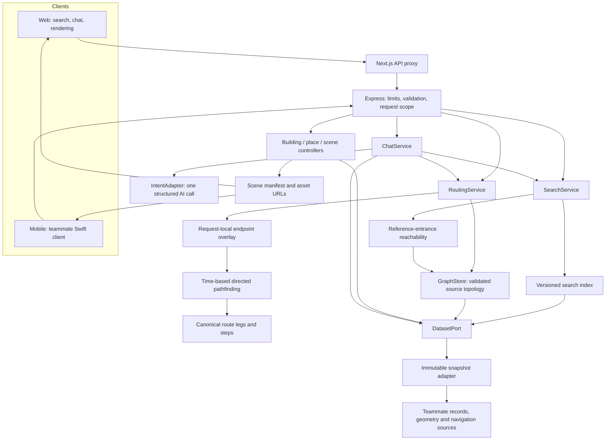
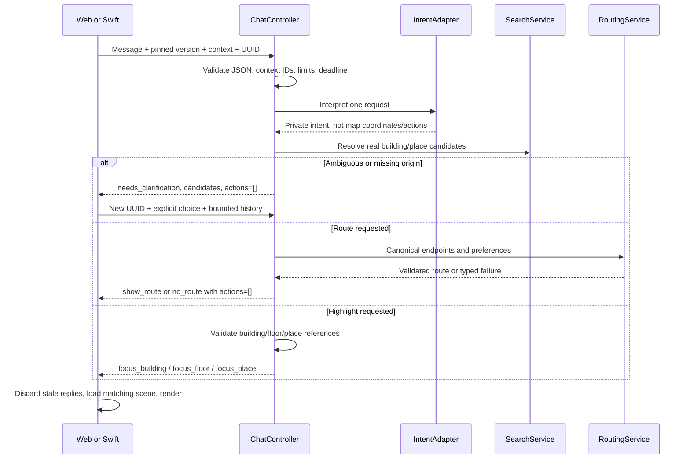

# Backend implementation and integration guide

The agreed HTTP contract remains `shared/contracts/openapi.yaml` / `openapi.json`. No account, campus-code, public editing, event-feed, or image-analysis module has been added. This integration leaves the current Swift directory and its separate pull request unchanged. This guide describes the implemented backend and the boundary with the dataset and renderer owners.

## Architecture and ownership



Eddie's implementation is in `server/src/modules/search`, `routing`, `chat`, `integrations/ai`, `lib`, `middleware`, and `bootstrap`. The building/place/scene HTTP modules are thin adapters over `DatasetPort`; the teammate still owns the real records, measured geometry, object mappings, and source topology. The included file adapter is a reference implementation, not a requirement to reorganize the teammate's authoring files.

`createServices()` composes one shared search service, graph cache, routing service, and chat service. Chat calls these services in-process. `createApp(services, options)` has no listening or credential side effects, so tests can inject data and AI implementations. `server.ts` loads configuration and complete publications, validates enabled graphs, then listens. Navigation-disabled buildings do not require a graph and remain searchable.

## Running the implementation

From the repository root:

```sh
npm install
npm run dev                 # web on 3000, API on 4000
# Open /?building=LAW&floor=1 on the web server.
# The separate saved-campus demo still uses npm run dev:campus on 3001.
npm test
npm run typecheck
npm run build
```

Development defaults to `DATASET_MODE=files` with the bundled `server/data/snapshots/` publication. The API-backed viewer loads the same versioned records, geometry and coordinates used by search, chat and routing. The publication is illustrative and unverified; production startup intentionally rejects it. `DATASET_MODE=prototype` remains an explicit compatibility mode with a development preview endpoint; the current viewer uses file-backed `/api/routes`.

Copy `server/.env.example` to `server/.env` for configuration. To enable real AI interpretation, set `AI_PROVIDER=openai`, `OPENAI_API_KEY`, and `OPENAI_MODEL` to a model available to your account with structured-output support. No key or model is invented, and no canned fallback impersonates the provider. With `AI_PROVIDER=disabled`, chat returns `501 FEATURE_DISABLED`; search still works.

The provider uses the OpenAI Responses API with `store: false`, a strict JSON intent schema, one call per turn, a 1,500-token output bound, no automatic retries, cancellation, and a concurrency admission limit. Refusal becomes `unsupported`; incomplete/malformed output or transport failure becomes a dependency error. These choices follow the [official structured-output documentation](https://developers.openai.com/api/docs/guides/structured-outputs). Provider behavior is tested with injected responses; live model quality and credential/account access need an actual configured provider.

## HTTP contract

Every API path below starts with `/api`. Canonical identifiers are case-sensitive; use directory/search to resolve names and aliases. `LAW`, `LAW-101`, and floor `1` are examples, not values to derive by parsing opaque IDs.

GET requests may omit `dataVersion` only for initial discovery. Capture the returned version and send it with related reads, routes, and chat. POST bodies require `dataVersion` and a UUID `clientRequestId`. The server echoes the latter so clients can discard stale results; it is not a persistence or idempotency key.

| Method and endpoint                            | Inputs                                                                             | Response and behavior                                                                                                                     |
| ---------------------------------------------- | ---------------------------------------------------------------------------------- | ----------------------------------------------------------------------------------------------------------------------------------------- |
| GET `/health`                                  | Optional `X-Request-ID`                                                            | `{status: "ok", service: "trojan-compass-api"}`; no model call; no caching.                                                               |
| GET `/buildings`                               | `q`, `limit`, `cursor`, `dataVersion`                                              | `BuildingListResponse`; empty query lists by code; aliases included in matching.                                                          |
| GET `/buildings/{buildingId}`                  | `dataVersion`                                                                      | `BuildingResponse`; metadata, capabilities, floors, bounds, coordinates, provenance.                                                      |
| GET `/buildings/{buildingId}/floors`           | `dataVersion`                                                                      | `FloorListResponse`; floor order comes from `sortOrder`, not lexical floor IDs.                                                           |
| GET `/buildings/{buildingId}/floors/{floorId}` | `dataVersion`                                                                      | `FloorResponse`; floor, its places, and optional procedural geometry. Missing geometry is null.                                           |
| GET `/buildings/{buildingId}/places`           | `q`, `floorId`, `kind`, `limit`, `cursor`, `dataVersion`                           | `PlaceListResponse`; empty query lists the building's filtered places.                                                                    |
| GET `/buildings/{buildingId}/places/{placeId}` | `dataVersion`                                                                      | `PlaceResponse`; canonical location, access-point references, and optional scene object key.                                              |
| GET `/places`                                  | `q`, `buildingId`, `floorId`, `kind`, `stepFree`, `limit`, `cursor`, `dataVersion` | `PlaceSearchResponse`; unscoped empty query returns no results. `floorId` requires `buildingId`.                                          |
| GET `/buildings/{buildingId}/scene`            | `representation=auto\|procedural\|glb\|usdz`, `dataVersion`                        | `SceneResponse`; returns a published scene, never generates a building. Unsupported representation returns 406; absent scene returns 501. |
| POST `/routes`                                 | `RouteRequest` (optional `via` place stop)                                          | `RouteResponse`; computed path, normalized endpoints, geometry, instructions, estimates, warnings.                                        |
| POST `/chat`                                   | `ChatTextRequest`                                                                  | `ChatResponse`; resolved actions, clarification candidates, not-found, no-route, or unsupported turn.                                     |
| GET `/buildings/{buildingId}/graph`            | `dataVersion`; deployment must enable `EXPOSE_GRAPH`                               | `GraphResponse`; validated source graph for inspection. Normal clients use `/routes`.                                                     |
| GET `/events`, `/events/{eventId}`             | Deferred                                                                           | 501 `FEATURE_DISABLED`.                                                                                                                   |

Search text is at most 200 characters. Limits are integers 1–100, default 20. Query booleans accept exactly `true` or `false`. Repeated or unknown parameters are rejected. JSON bodies are limited to one MiB; chat text to 4,000 characters and history to 20 user/assistant messages of at most 4,000 characters each. Multipart chat returns `501 IMAGE_INPUT_DISABLED` before parsing uploads.

Collection responses include `requestId`, `dataVersion`, `items`, and `nextCursor`. Detail responses contain their named record. Full field definitions and all 50 positive/negative examples are in `shared/contracts` and `shared/fixtures`; automated tests validate every example against the runtime schema.

Search cursors are HMAC-protected and bind the version, normalized query, filters, ranking revision, and page size. Do not edit, decode for application logic, or reuse them after changing a filter. Cursors do not expose a mutable array offset. `CURSOR_SECRET` must be stable across replicas. A development restart with an ephemeral secret invalidates older cursors.

GET responses use stable ETags excluding the request ID and `private, no-cache` revalidation. POST responses and errors use `no-store`. The `X-Request-ID` response header is present even for malformed JSON; valid incoming IDs are echoed. Invalid correlation IDs receive a generated ID and a 400 error.

## Route request and response

```json
{
  "clientRequestId": "d49b977a-3cda-45c3-9dd9-bf0a281b8a11",
  "dataVersion": "your-published-version",
  "origin": { "kind": "place", "buildingId": "LAW", "placeId": "LAW-101" },
  "destination": { "kind": "place", "buildingId": "LAW", "placeId": "LAW-103" },
  "mode": "fastest",
  "stepFree": false,
  "accessProfile": "public"
}
```

A picked endpoint uses `{kind: "position", buildingId, floorId, position: {x,y,z}}`. Coordinates are building-local meters, Y up, right-handed. Outdoor coordinates use WGS84 only when a real outdoor network is supplied; this implementation deliberately returns `OUTDOOR_NETWORK_UNAVAILABLE` for cross-building routes. There is no synthetic campus-line fallback or persisted route endpoint.

The route engine:

1. Validates the request, pinned version, canonical endpoints, and building capability.
2. Loads a shared immutable graph keyed by version and building.
3. Considers every public access point for a place, including direction-specific entry/exit permissions.
4. Validates arbitrary picks against floor elevation, public walkable polygons, holes, and barriers. Corridor picks snap at most two meters along a wall-safe segment. Room picks connect only through documented room access points; their interior walking distance is included rather than called snapping.
5. Builds a private overlay for this request. Directed corridor edges are split in order when both endpoints fall on one edge. Shared graph arrays are never mutated.
6. Runs heap-based Dijkstra over estimated travel time. `fastest` permits eligible connectors; `stairs` excludes elevators; `elevator` excludes stairs. `stairs` plus `stepFree=true` is invalid. Public routing excludes restricted, USC-only, and unknown-access paths.
7. Charges an elevator wait once per continuous ride, not per floor. Walking, ramps, stairs, and lifts have separate estimated speeds. Physical distances remain separate from cost penalties.
8. Emits contiguous indoor and vertical legs, canonical normalized endpoints, valid step anchors, explicit provenance, and estimated timing warnings. Same-position/place requests still produce a valid zero-distance leg and arrival instruction after access validation.

A verified step-free path requires positive evidence across edges, regions, doors, connectors, endpoint bindings, access points, and places. Missing evidence, missing dated source references, or `unknown` never becomes verified. A diagnostic second pass may distinguish an unknown-accessibility path from no path; it never returns that path as an accessible route. Reference-entrance search uses forward reachability and preserves one-way restrictions.

## AI and clarification workflow



The model cannot choose an invented room ID, fabricate geometry, verify accessibility, or bypass public access restrictions. It supplies text intent only. The server resolves names using the same search service used by manual search, calls the same routing service, and constructs final actions and messages. Citations are drawn only from existing dataset sources. A provider failure remains HTTP 503/504, not a fabricated not-found response.

`context.origin` is the starting point. `context.selectedPlace` is a selection, not an origin. A newly named destination overrides a stale selection; selection is used only for an explicit reference such as “there.” An explicitly named building overrides the current viewport. Unresolved “outside” produces entrance choices rather than a guessed entrance.

For an ambiguous room, send the chosen canonical code/ID in the next message, include the preceding question in bounded history, and optionally set `selectedPlace` to the candidate's place reference. For a missing origin, set `context.origin` to the confirmed start and repeat the original route request with a new `clientRequestId`. Do not put the starting location in `selectedPlace`. This is stateless; there is no hidden chat session or new clarification-token API.

Only `status=resolved` may change the map. `needs_clarification`, `not_found`, `no_route`, and `unsupported` return no actions. Both clients must discard a reply if a newer request or a different data version has replaced its context.

## Teammate dataset handoff

The published authoring-file adapter already implements `DatasetPort`. A future dataset may use the same files, implement the methods in `server/src/ports/service-ports.ts`, or export a normalized `DatasetSnapshot`. The public HTTP contract is unchanged. The internal navigation input is now defined in `ports/navigation-source.ts` and validated in `modules/routing/source-schema.ts` plus domain checks in `graph-store.ts`.

| Source field                              | What the data owner supplies                                                                                                                                                                    |
| ----------------------------------------- | ----------------------------------------------------------------------------------------------------------------------------------------------------------------------------------------------- |
| `buildingId`, `dataVersion`, `provenance` | Stable canonical identity, immutable publication version, truthful source/verification metadata.                                                                                                |
| `nodes`, `edges`                          | Floor-scoped positions, directed connectivity, actual polyline lengths, access and step-free claims. Node IDs must be unique per building.                                                      |
| `geometry`                                | Null for place-to-place graph-only routing; otherwise floor records with elevation, bounds, public walkable regions, and blocked polygons. Missing floor geometry disables picks on that floor. |
| `edgeDetails`                             | Exactly one record per edge: oriented geometry, involved region IDs, door/connector reference, access evidence, estimated-metric flag.                                                          |
| `doors`                                   | Regions on each side or an outside side, floor, allowed direction, edge IDs, and access evidence. Room/corridor crossings require explicit door edges.                                          |
| `connectors`                              | Stairs/elevator/ramp identity, served floors, connector edge IDs, and access evidence. Cross-floor edges require matching connectors.                                                           |
| `placeAccessBindings`                     | Every place access point mapped to an existing node, floor, region (or null for graph-only input), door if applicable, policy-dependent approach edges, and evidence.                           |
| `referenceEntrances`                      | Documented entry-allowed entrance place/access-point pairs for accessibility search.                                                                                                            |
| `evidence`                                | Unique evidence IDs with source URLs, verification timestamp, step-free status, and note. Unknown evidence must stay unknown.                                                                   |

Polygon rings must be closed, finite, nonzero-area, non-self-intersecting, with strictly interior, non-overlapping holes. Edges must follow their declared walkable regions and avoid barriers, including thin barriers between endpoints. Runtime validation checks references, directions, floor membership, geometry endpoints, and physical distances. The adapter does not invent missing walls, doors, vertical connectors or georeferencing. For the current publication it derives open corridor regions from slab boxes minus closed rooms and blocked areas, and validates every resulting edge against those polygons. Disconnected corridor components may be joined only by an unobstructed segment wholly within published public corridor space. Derived links never change source files or establish accessibility evidence. `openAreaApproaches: true` allows a picked point to walk to a visible corridor connection instead of snapping across a large distance; without that flag, the two-meter snap limit remains.

For a graph-only publication set `geometry: null`, use empty edge region lists, and set binding `regionId: null`. Door records that reference interior regions require geometry; graph-only data may use appropriately documented public access-point/edge policy without accepting arbitrary picks. `navigation=false` requires no source graph. `verifiedStepFreeRouting` should reflect actual coverage; proof still must pass the route engine.

The file adapter accepts the teammate's existing publication layout directly: `current.json` contains `{dataVersion}`, followed by a version manifest and `buildings/{id}/{building,places,floors,scene}.json`, `geometry/{floorId}.json`, and the four navigation files. Source records remain immutable. Scene URLs resolve against `VIEWER_BASE_URL` and `PUBLIC_API_BASE_URL` (development defaults: localhost:3000 and 127.0.0.1:4000); configure public HTTPS origins for mobile/deployment. This layout currently retains one active version. Use the normalized bundle format below for multiple retained versions.

The same loader also accepts a normalized publication:

```text
DATASET_ROOT/
  current.json
  version-a/dataset.json
  version-b/dataset.json
```

```json
{
  "currentVersion": "version-b",
  "availableVersions": ["version-a", "version-b"]
}
```

Each `dataset.json` contains `{dataVersion, buildings, places, scenes, floorGeometry, navigation}` arrays matching `DatasetSnapshot`. This is an alternative normalized export bundle; no migration of the current authoring files is required. Do not rewrite source authoring files into runtime cache structures.

The loader accepts at most eight versions and 32 MiB per bundle, rejects traversal/symlink escapes, freezes records, and checks cross-record references. Each navigation source is limited to 50,000 nodes/edges, 100,000 total geometry/polyline points, and bounded rings/arrays. Production refuses demo or unreviewed building/navigation provenance; these declarations still require real human/source verification outside the algorithm.

Validate before publication:

```sh
npm run validate:data --workspace=@trojan-compass/api -- /absolute/path/to/snapshots
# For production publication checks, set NODE_ENV=production.
```

Create a new version directory completely before atomically replacing `current.json`, then roll/restart the service. Existing replicas serve their old immutable in-memory publication until restarted. Keep a compatible version set across replicas during a rollout and retain versions still used by active clients. Never overwrite a published version's content. No administrative write API is exposed.

## Web and mobile integration

The web search, chat and Directions panels call the backend. `web/src/lib/api-client.ts` supplies timeouts, cancellation, version checks, and POST request-ID matching. `LatestRequest` coordinates all asynchronous map mutations. A newer query, location change, floor selection, or unmount invalidates pending work. `ViewerSession` stages and validates every building/floor/place in an action batch before installing any viewer state; failed or stale batches cannot partially replace the scene. Failed search preserves the current selection, while editing direction inputs or preferences clears a now-obsolete route.

The viewer consumes published scene manifests and floor geometry. Both geometry and route positions are already in building-local meters, with Y up. `route-scene.ts` adds only a small rendering lift; it does not divide horizontal coordinates by the old prototype scale. Stable place IDs survive map picks, including two restrooms with the same label. Saved-link routes, manual controls and AI route actions all use canonical `/api/routes` behavior, with no fallback to preview routing.

The Directions view retains the header, sidebar, building model and floor controls. Walking legs draw green lines with destination-facing arrows. Vertical legs remain distinct and draw upright translucent blue markers with an up/down platform and a clickable destination-floor label. The marker encloses the actual landing positions without drawing a diagonal walking line between offset floors; it is a symbolic indicator, not surveyed shaft geometry. Motion respects reduced-motion preferences. Sidebar steps change the selected floor and emphasize the active leg.

`PreviewRoutingService` remains available only in explicit non-production prototype mode for compatibility tests. It is not used by the published viewer and never replaces a failed canonical route. The default file publication still contains inferred geometry and unknown accessibility. See `docs/integration-review.md` for current data gaps and the acceptance matrix.

The mobile teammate should implement native decoding of the same shared schemas, initial version discovery, cancellable requests, stale-response checks, all chat statuses, and the four action variants. Rendering/camera/gestures stay local. Fetch assets from scene metadata; keep network positions in canonical meters and apply an explicit renderer transform. A GLB/ USDZ choice is a scene negotiation, not a different backend. An actual iPhone uses the hosted HTTPS backend, not its own `localhost`.

## Errors and operations

| Status/code                                     | Client behavior                                                                 |
| ----------------------------------------------- | ------------------------------------------------------------------------------- |
| 400 `INVALID_REQUEST`                           | Correct the indicated fields; no automatic retry.                               |
| 404 `RESOURCE_NOT_FOUND`                        | Discard missing selection or show unavailable location.                         |
| 406 `REPRESENTATION_UNAVAILABLE`                | Use `auto` or a listed supported scene format.                                  |
| 409 `DATA_VERSION_MISMATCH`                     | Clear mixed-version state and rediscover.                                       |
| 410 `DATA_VERSION_UNAVAILABLE`                  | Rediscover the directory and clear old scene/route state.                       |
| 413 / 415                                       | Reduce body size or send uncompressed UTF-8 JSON.                               |
| 422 `INVALID_POSITION`                          | Ask for another public map pick or listed place.                                |
| 422 `NO_ROUTE`                                  | Show no route for these endpoints/preferences.                                  |
| 422 `UNVERIFIED_ACCESSIBILITY`                  | Explain missing verification; do not draw a supposedly accessible path.         |
| 422 `OUTDOOR_NETWORK_UNAVAILABLE`               | Keep the destination searchable; explain cross-building routing is unavailable. |
| 429 `RATE_LIMITED`                              | Honor `Retry-After`; do not retry rapidly.                                      |
| 501 `FEATURE_DISABLED` / `IMAGE_INPUT_DISABLED` | Hide or explain the unavailable capability.                                     |
| 503 / 504                                       | Offer a user-initiated retry; keep manual search usable when AI is unavailable. |
| 500 `INTERNAL_ERROR`                            | Show the request ID; internal exception text is not returned.                   |

Default lookup/routing budget is 10 seconds; chat is 45 seconds. The browser allows 15/60 seconds respectively. Disconnects and shutdown abort request work. CPU-intensive loops check a monotonic deadline and yield; shared preparation has its own budget so one caller's cancellation cannot cancel everyone else's graph/index. Failed cache preparations are evicted. Elevator/route calculations use request-local overlays.

Logs contain request ID, route template, method, status, duration, and error code. They omit request text, search strings, raw URLs, IPs, and location coordinates. Runtime logs expose event-loop delay and heap usage. There is no student account or message-history storage. Provider-side retention is governed by the provider/account configuration; `store:false` is not a claim about all provider retention.

CORS allows exact configured origins; originless native requests work. `TRUST_PROXY_CIDRS` must name actual proxies so IP-based limits behave correctly behind Next.js/ingress. Default limits are 240 general requests/minute/IP, 20 chat requests/minute/IP, and eight in-flight provider calls. These are **per process**. A public multi-replica deployment needs coordinated edge limits/provider quotas; these defaults are not a distributed quota system. The in-memory snapshot and graph/index caches are bounded, but capacity should be load-tested with the real corpus and deployment hardware.

Graceful shutdown stops accepting connections, drains current work for up to ten seconds, then aborts and closes remaining connections. Configure upstream timeouts above the chat budget and terminate TLS at a trusted ingress. A node failure does not lose accounts/routes because neither is persisted here.

## Container and release checks

```sh
docker build -f server/Dockerfile -t trojan-compass-api .
# Mount the completed publication read-only at /data; provide runtime secrets/config.
# The image runs as a non-root user and listens on 4000.
```

The image includes compiled server code and the authoritative schema, not frontend assets or credentials. Production needs `CURSOR_SECRET`, a reviewed dataset publication, exact HTTPS browser origins, and provider settings if chat is enabled. Use your secret manager; do not bake credentials into images or commit them.

CI runs installation, type checking, compatibility drift checks, behavioral tests, a production build, and an HTTP smoke run through the built Next.js proxy. Smoke chat uses a fixed intent fixture, not a live provider. Tests cover wire fixtures, request/error envelopes, normalization/pagination, directionality, room doors, two picks on one edge, simultaneous requests, elevator cost, accessibility proof, invalid geometry, immutable snapshots, publication boundaries, chat clarification, provider admission, cancellation, CORS, and cache validators.

A passing build/test suite establishes the implementation behavior. Launch readiness additionally requires real dataset and accessibility review, an exercised live model configuration, physical-device/mobile integration for the published scenes, and representative deployment load testing. This change supplies the code and tests for Eddie's portion; it does not invent those external inputs.
