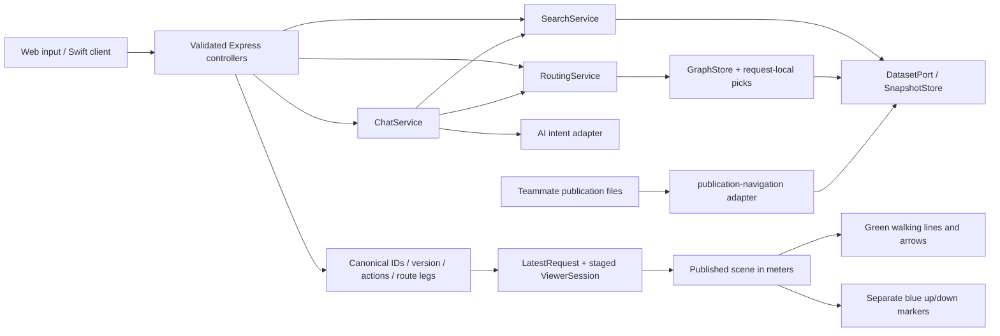

# Search, routing and chat integration review

This branch integrates Eddie's search, routing, AI intent/orchestration and HTTP implementation with the building-data and viewer work from `c118d93`, including the architecture document added on `main` in `3975337`. It preserves history and is intended for a reviewed pull request, not an automatic merge or a force push.

## Ownership and connection

| Area                                                       | Integration decision                                                                  |
| ---------------------------------------------------------- | ------------------------------------------------------------------------------------- |
| Search, routing, chat, AI provider and HTTP composition    | Eddie's controller/service implementations remain authoritative.                      |
| Published building records, geometry, names and IDs        | Teammate's files retained unchanged; converted through an explicit read-only adapter. |
| API-backed viewer, camera, models, picking and campus demo | Retained and connected to canonical route legs and our direction UI.                  |
| Shared HTTP shapes and Swift models                        | No OpenAPI, shared model or `mobile/` changes in this PR.                             |
| Mobile PR #1                                               | Separate integration; its existing conflicts are not resolved by this PR.             |

Only `bootstrap/services.ts` composes the application services. Chat calls the same search and route instances as the manual endpoints. The AI supplies intent, never authoritative coordinates, access evidence, room records or a hand-drawn route. The viewer uses `/api/routes`; it does not silently retry a failed route against a preview engine.

## Data adaptation

The source uses split files and a `{dataVersion}` pointer. The adapter loads that format directly and also retains support for the normalized multi-version `dataset.json` format. It derives floor regions from the published slabs minus closed rooms and blocked areas, preserves explicit door edges and connector memberships, and validates all resulting geometry.

Obstructed/out-of-bounds corridor points and wall-crossing edges are excluded from the derived graph. An obstructed arrival or connector node is a publication error. Disconnected corridor components may be joined only by a segment fully inside public corridor space that avoids every barrier; no missing room door or vertical connection is invented. The full floor geometry explicitly enables walked approaches for open-area picks. Other datasets keep the original two-meter corridor snap rule. Every request uses an isolated endpoint overlay, leaving cached graphs unchanged.

Both the new scene and the route already use meters. The old horizontal prototype conversion is deliberately not applied again. Vertical route legs stay separate from walking legs, including offset landings; their blue volume is a symbolic floor-change indicator.

## Acceptance evidence

| Behavior                                                                                 | Regression evidence                                                                       |
| ---------------------------------------------------------------------------------------- | ----------------------------------------------------------------------------------------- |
| Unchanged public contract and fixture decoding                                           | `npm run contract:check`, shared fixture checks                                           |
| Nine building publications validate                                                      | Startup graph preparation and API/interior tests                                          |
| Search aliases, IDs, filters, ambiguity and pagination                                   | Canonical search + HTTP tests; browser LAW/VKC alias and room checks                      |
| Every destination in the eight reconstructed non-LAW buildings                           | Existing interior route matrix retained and run through our services                      |
| LAW destination/mode sweep                                                               | 213 successful route combinations; five explicit known gaps below                         |
| No wall shortcuts, no unauthorized room entry, directed edges                            | Geometry, canonical routing and published-data tests; startup validation of derived edges |
| Open-area positions preserved and repeated/concurrent picks isolated                     | Published HTTP and canonical overlay tests                                                |
| Stairs/elevator preferences, zero-length arrival and accessibility evidence              | Routing tests and browser controls                                                        |
| Manual and chat routing share one result                                                 | Published API chat test with deterministic intents                                        |
| Provider malformed output, timeout, refusal and admission limits                         | Injected provider tests; no live-model claim                                              |
| Failed action batches and stale replies preserve newer UI state                          | Viewer staging, transport and LatestRequest race tests                                    |
| Coordinates, duplicate restroom IDs, upward/downward blue markers, green arrow direction | Directions and live viewer contract tests                                                 |
| Built web assets, API proxy, scene mappings, route and chat orchestration                | `npm run smoke` with a fixed test intent                                                  |

Local verification: 110 automated tests passed, workspace type checks passed, and production build passed. The browser check exercised the actual form, stair routes both directions, elevator selection, sidebar Next/floor changes, normalized room search, a building alias, invalid-place handling and unavailable-provider draft preservation. CI reruns type checks, tests, build and smoke against the PR revision.

## Known publication gaps and deployment limits

For the pinned `usc-interiors-2026-11-14` LAW snapshot, a sweep starting at `LAW-101` finds no supported path to `LAW-216` in either stairs or elevator mode. Its room/door component has no supported corridor connection. Elevator-only requests to `LAW-1-stairsNW`, `LAW-4-stairsNW`, and `LAW-4-stairsNE` also have no path that avoids stairs. These five combinations return `NO_ROUTE` and remain explicitly covered so an accidental fabricated path cannot mask the source problem. The data owner should correct/verify connections in a new publication; this PR does not edit source coordinates to force a pass. Search and highlighting remain available for these places.

The publication has no verified step-free evidence. Checking Accessibility returns `UNVERIFIED_ACCESSIBILITY` where proof is absent; selecting Elevators alone excludes stairs without claiming verified accessible access. Cross-building routes remain unavailable until an outdoor network exists.

Live AI is disabled until `AI_PROVIDER=openai`, `OPENAI_API_KEY` and `OPENAI_MODEL` are configured. Orchestration/provider-failure behavior is tested with fixtures, while live model quality and credentials still require a real integration check. The old `AI_MODE`/`AI_API_KEY` settings are replaced by the documented server configuration. No secrets are included.

Production admission still requires reviewed non-demo data and a stable cursor secret. Mobile/device testing, real-world geometry/access verification, distributed quotas and representative load testing remain separate release work. Passing this suite is evidence for the covered behavior, not a guarantee that every real campus trip is possible.

## Merge and teammate workflow

1. Review this PR's authoritative service changes and adapter together. Do not resolve future service conflicts by taking the teammate's older search/routing/chat files wholesale.
2. Keep published datasets and shared API shapes stable. New data versions should run the same validation and route coverage checks before changing the current pointer.
3. Rebase or merge the latest `main` into the PR branch if it advances; rerun CI. GitHub mergeability only establishes textual compatibility, not runtime behavior.
4. Merge only after review of the code and the explicit data/provider limits. This task creates the PR and leaves the final merge to the team.
5. Resolve the mobile PR independently against the agreed `web/`, `mobile/`, `server/`, `shared/` layout. Mobile should use canonical IDs, version pinning, current scene URLs and the same route/chat actions. It should not import a second search or routing engine.

For a local demo, run `npm run dev` and open `/map?building=LAW&floor=4&from=LAW-101&to=LAW-4-restroom-2&mode=stairs`, then open Search & tools → Directions. `npm run smoke` needs the API port used by the built proxy to be free; use `SMOKE_API_PORT` with a matching build-time `API_BASE_URL` for another port. The integration checkout is separate from the original working app.
